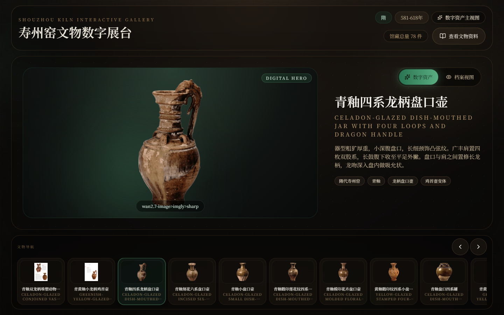
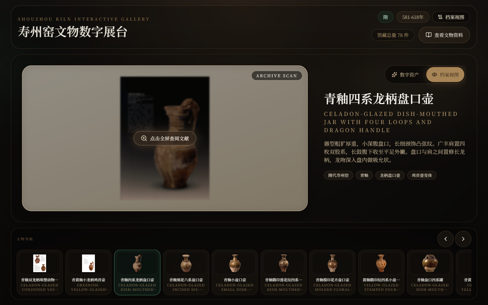
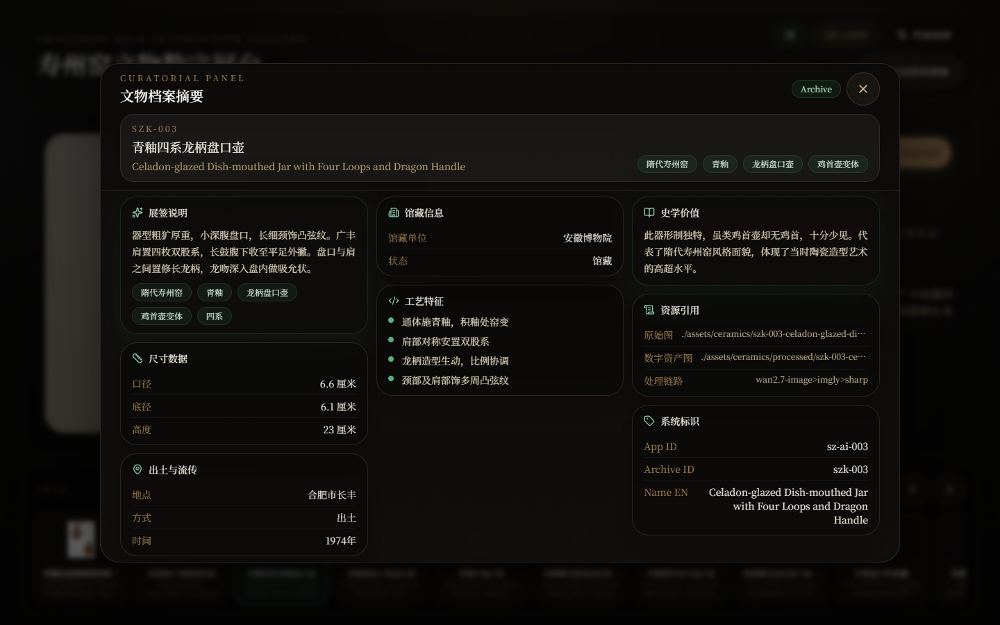
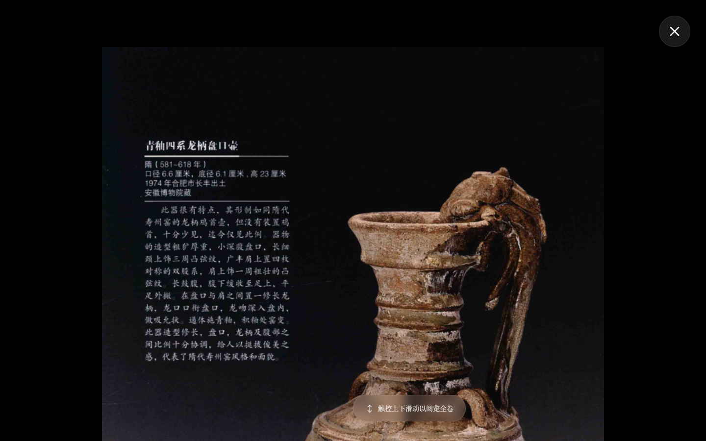

# Shouzhou Kiln Interactive Gallery

[简体中文](README.md) · **[Explore the live gallery ↗](https://shouzhou-kiln-interactive.yuxuan.wiki/)** · [Run locally](#run-locally) · [Development guide](docs/DEVELOPMENT.en.md)


*Shouzhou kiln thematic illustration · AI-generated*

Explore Shouzhou kiln ceramics through their forms and archival details. This browser-based gallery brings together images, descriptions and records for **78 artifacts**, connecting each object with its dimensions, excavation and collection information.

Designed for cultural exhibitions, classroom discussion and portfolio presentations, the project also provides a React foundation for developers to build galleries around their own collections using local JSON and images.

**78 artifacts · 76 processed images · Archival comparison · Fullscreen reading · Static deployment**

## Start with an artifact

Open the [live gallery](https://shouzhou-kiln-interactive.yuxuan.wiki/) and choose an artifact from the navigation strip. The main stage combines its image, Chinese and English names, description and feature tags. Use the left and right arrow keys to continue browsing.



*Application screenshot: celadon-glazed dish-mouthed jar with four loops and dragon handle (szk-003). Open the image for a larger view.*

| Explore the form and the archive | Open the artifact record |
| --- | --- |
|  |  |
| Switch between the processed image (“数字资产”) and archive view (“档案视图”). Artifacts with an archive image only open directly in archive view. | Select “查看文物资料” to read the dimensions, excavation and provenance, collection and technical features together. |

<details>
<summary><strong>Expand: read the archive in fullscreen</strong></summary>

Select the archive image to open the scanned page in fullscreen. Press `Esc` or use the close button to return to the gallery.



</details>

## Run locally

Install **Node.js 22** and npm, then run:

```sh
git clone https://github.com/HNNUYUXUAN/shouzhou-kiln-interactive.git
cd shouzhou-kiln-interactive
npm ci
npm run dev -- --host 127.0.0.1
```

Open the address printed in the terminal, usually [http://127.0.0.1:3000/](http://127.0.0.1:3000/). During development, saving a source file updates the preview.

Build the static site and preview it locally:

```sh
npm run check
npm run preview -- --host 127.0.0.1 --port 4173 --strictPort
```

Open [http://127.0.0.1:4173/](http://127.0.0.1:4173/). Serve `dist/` through an HTTP static server for a hosted site, local installation or intranet deployment.

**Stack:** React 18 · Vite 6 · Tailwind CSS 4. Browser requirements: Chrome 111+, Safari 16.4+, Firefox 128+.

## Choose your next step

| Your goal | Start here |
| --- | --- |
| Explore the exhibition | [Live gallery](https://shouzhou-kiln-interactive.yuxuan.wiki/) · [User guide](docs/USAGE.en.md) |
| Replace or add artifacts | [Development guide](docs/DEVELOPMENT.en.md): connect runtime data, images and archive records |
| Customize colors and layout | [Appearance guide](docs/DEVELOPMENT.en.md#2-customize-the-gallery-appearance): theme settings, global styles and components |
| Hand the project to an agent | [Agent guide](docs/AGENT_GUIDE.en.md) · [Discovery and citation](docs/DISCOVERY.en.md) · [llms.txt](llms.txt) |
| Find material sources | [Artifact inventory](docs/ASSET_INVENTORY.en.md) and [machine-readable manifest](docs/asset-rights.json) |
| Contribute or report an issue | [Contribution guide](CONTRIBUTING.en.md) · [Project issues](https://github.com/HNNUYUXUAN/shouzhou-kiln-interactive/issues) |

## Licensing and acknowledgments

**Code and original engineering documentation are licensed under [MIT](LICENSE)**, authored by **缪雨轩 (Miao Yuxuan)**. Reuse the gallery code for other themes while retaining the copyright and license notices.

**Artifact materials may be distributed for noncommercial learning and exchange.** Material authorization comes from the School of Art and Design, Huainan Normal University (淮南师范学院美术与设计学院); see the [material terms](ASSET_LICENSE.en.md). For commercial projects, use materials licensed for that purpose.

Thanks to the School of Art and Design, Huainan Normal University, for authorizing the use of the materials. See [third-party software notices](THIRD_PARTY_NOTICES.en.md) and the [visual asset notes](docs/assets/README.md) for software credits and the images used on this page.
